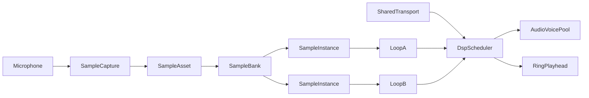
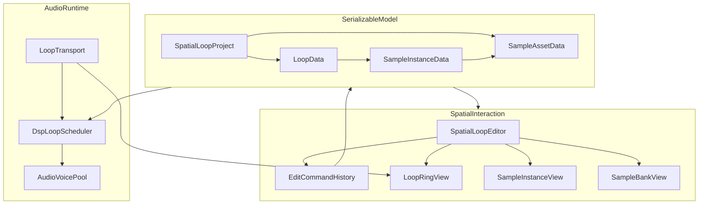

# Spatial Sample Loop

## Status

Concept and proof-of-concept plan for a sample-first VR music environment.

The core change is to stop representing music-making as a collection of virtual
machines. A recorded sound becomes a tangible object. Placing that object on a
ring schedules it in time, and manipulating the object changes the sound.

The first goal is not a complete VR DAW. It is to answer one question:

> Is recording, arranging, and performing directly with sample objects around a
> circular timeline more immediate and understandable than operating virtual
> samplers and sequencers?

## Product direction

The intended experience is closer to standing inside a musical timeline than
standing in a virtual studio:

- Record a sound and receive a physical sample object.
- Audition it immediately.
- Place it at an angle on the loop to choose when it plays.
- Grab it again to move it in time.
- Clone it to create a pattern.
- Read important sound properties from its shape and position.
- Hear edits on the next safe musical boundary.

The environment should expose musical structure directly. Hardware metaphors
are useful only when they make an action clearer; they are not the organizing
principle.

## Design principles

1. **The sample is the primary object.** Recording should produce something the
   player can immediately hold, hear, place, and copy.
2. **Position has stable meaning.** The same spatial axis must not mean different
   things in different modes unless the mode is unmistakable.
3. **Time is visible.** The ring, playhead, subdivisions, and sample arcs should
   make the current beat and the next trigger obvious.
4. **Clones remain recognizable.** Copies share a sample identity while retaining
   independent placement and performance settings.
5. **Edits are non-destructive by default.** Moving, pitching, gating, and adding
   effects to one instance should not silently alter every other instance.
6. **Performance is immediate; arrangement changes are deliberate.** Audition,
   hold, and repeat can be momentary. Persistent changes require a clear commit.
7. **Audio timing outranks visual timing.** The audio clock drives the playhead,
   not the other way around.
8. **The first version is designed for HTC Vive controllers.** Hand tracking and
   gloves can later drive the same semantic actions.

## Core conceptual model

The implementation and the interface should distinguish three concepts.

### Sample asset

A `SampleAsset` is the source sound:

- A recorded or imported audio clip
- A stable ID and display name
- Non-destructive trim bounds
- Source duration, channel count, and sample rate
- A stable visual identity, especially hue and base texture
- Optional default envelope and effect settings

Recording creates one asset. The raw recording should remain recoverable even
if the default trim or processing changes.

### Sample instance

A `SampleInstance` is one occurrence of an asset on one loop:

- Reference to a `SampleAsset`
- Start position in musical time
- Audible duration or gate
- Velocity/gain
- Pitch offset
- Attack and release
- Mute state
- Optional per-instance effect overrides

Cloning a sample object creates another instance referencing the same asset. It
does not copy the audio data. Moving or pitching a clone changes that instance
only. Editing the asset's trim or identity can intentionally update all of its
instances.

### Loop

A `Loop` contains:

- Length in bars or beats
- Time signature
- Quantization settings
- Sample instances
- Optional loop-level effect and mix settings

For the PoC, tempo belongs to the shared transport rather than to each loop.
That keeps loop switching predictable. Polymetric and independently clocked
loops can be explored later.

## Spatial vocabulary

### Ring and time

- The loop is a room-anchored ring around a calibrated center.
- Zero time is at 12 o'clock/forward from the center.
- Time advances clockwise when viewed from above.
- One revolution is one loop.
- Major markers show bars and quarter notes; minor markers show the active
  quantization grid.
- A playhead travels around the ring. The ring itself should remain stationary
  so placed objects do not appear to move under the player's hands.
- Crossing zero is continuous. An arc may visibly wrap through the end and
  beginning of the loop.

The ring should be centered from the tracking origin or an explicit calibration
gesture, not continuously attached to the headset. A recenter action can move
the workspace when needed.

### Sample mappings

Use the following mappings as the initial visual grammar:

- **Angle around the ring:** start time
- **Arc length:** scheduled audible duration in beats
- **Vertical position:** pitch offset
- **Object thickness or waveform amplitude:** velocity/gain
- **Leading edge profile:** attack
- **Trailing edge profile:** release
- **Hue:** sample-asset identity
- **Emission pulse:** transient state such as playing, selected, armed, or
  recording

This resolves an important conflict between "height as velocity" and "vertical
position as pitch." The whole object moves vertically for pitch. Its radial
thickness or waveform extrusion communicates velocity without changing pitch.

Arc length should mean duration in musical time, not merely the source file's
length in seconds. A newly placed instance can derive its initial arc from the
trimmed clip duration at the current tempo. In the PoC:

- Natural one-shots play at their original rate.
- Shortening the arc gates the sample.
- Lengthening beyond the source duration does not time-stretch it.
- Time stretching and tempo warping are deferred.

### Radial position and lanes

Radial distance is valuable for organization and reach, so it should not be
overloaded as another continuous sound parameter.

Use shallow radial lanes to separate overlapping arcs or optionally group
families such as drums, vocals, and tonal material. Lanes are layout aids, not
hard mixer tracks. A sample remains an independent object and may be moved
between lanes without changing its sound.

When two instances overlap at the same angle, the interface can fan them across
nearby lanes while preserving their exact start times.

### Pitch

The loop's base plane is the asset's original pitch. Moving an instance upward
or downward changes pitch in semitones:

- Default: semitone snapping
- Optional: scale snapping
- Precision modifier: cents or continuous pitch
- Clear return-to-original notch at zero

The usable height should stay within comfortable reach. Larger pitch ranges can
scroll or fold rather than forcing floor-to-ceiling placement.

### Attack and release

The front and back of an arc should visibly taper according to attack and
release. Selecting an instance exposes handles on those edges:

- Pull the leading handle backward to lengthen attack.
- Pull the trailing handle forward to lengthen release.
- Keep the timing anchor visible while editing.
- Prevent the two handles from crossing.

A lightweight waveform silhouette inside the object will make trim, transient,
and envelope changes easier to understand than a plain cube or sphere.

## Visual language

Visual channels should have consistent responsibilities instead of attempting
to encode every parameter simultaneously.

### Color

**Hue identifies the sample asset.** Every kick clone made from the same
recording has the same hue. Different recordings receive distinct hues, with
manual override available later.

**Saturation shows availability or bypass.** Muted or unavailable objects become
desaturated, but also receive a mute glyph or outline so color is never the only
signal.

**Value may reinforce loudness**, but thickness remains the primary velocity
encoding. Very dark values should be avoided because they obscure shape in VR.

Do not use hue as the primary effect indicator. Doing so would make clones stop
looking related as soon as their effects differ.

### Emission and brightness

Emission is best used for state over time:

- Brief pulse when an instance triggers
- Strong steady glow while selected
- Rhythmic pulse while latched or repeating
- Red or warm pulse while recording
- Moving highlight as the playhead approaches

Because emission is transient, it remains readable even when several static
properties are already encoded in the object's shape.

### Alpha

Transparency should mean "not fully concrete":

- Delay taps and reverb-tail previews
- Ghost locations from a preset
- Placement and clone previews
- Inactive-loop context
- Pending edits that have not yet committed

Essential objects and states should not rely only on alpha; transparent objects
are harder to select and can render poorly when many overlap.

### Textures and material motion

Textures can communicate broad effect families:

- Concentric ripples or repeated bands: delay
- Soft animated halo: reverb
- Moving cutoff band: filter
- Rough/noisy displacement: distortion
- Fragmented or particle-like surface: granular processing
- Chopped stripes: gate or tremolo

These are category cues, not complete effect editors. Editable effects also need
physical handles, halos, or small satellites with an obvious relationship to
their sample.

## Core interactions

Exact controller bindings should be tested, but the actions should remain stable
across input devices.

### Record

1. Hold the record control.
2. The central transport and the forming sample object show recording state.
3. Release to stop.
4. Silence trim runs and the new object appears in hand or at a nearby spawn
   point.
5. The object is also added to the sample bank.
6. Trigger auditions it immediately; placing it on the ring schedules it.

If recording fails, no empty object should be created. The interface should show
the selected microphone and input level before recording.

### Place and move

- Grip grabs an object.
- While held near the ring, a ghost shows its snapped time.
- Releasing commits the placement.
- A modifier disables snapping for free placement.
- Moving an existing instance keeps the old event active until the new placement
  commits, preventing accidental silence during performance.
- By default, edits take effect at the next subdivision or loop boundary,
  depending on their scope.

### Clone

While holding an instance, use an explicit clone action such as the Vive menu
button or grip-plus-trigger chord. The original remains in place and the clone
appears in hand.

Useful accelerated forms can follow after the basic clone is reliable:

- Clone every quarter note
- Clone every selected subdivision
- Radial drag to preview an evenly spaced set
- Duplicate an entire family or lane

All generated copies should remain normal editable instances.

### Audition, hold, and repeat

- Trigger on a sample: immediate audition without changing the loop
- Hold trigger: sustain or latch according to sample mode
- Touchpad while held: choose repeat division such as 1/4, 1/8, 1/16, or 1/32
- Release: return to the arranged loop
- Explicit commit action: turn the performed repeats into instances

Repeat mode should display temporary ghost subdivisions around the object. This
supports ad-hoc performance without silently rewriting the arrangement.

### Delete and undo

Removing an instance from a loop does not delete its source asset. Deleting an
asset from the bank requires confirmation when instances still reference it.

Every arrangement edit should be represented as a reversible command. Undo is a
PoC requirement once more than basic placement is supported; destructive VR
mistakes are otherwise too expensive.

## Feature designs

### Effects

Effects should remain non-destructive and have three explicit scopes:

1. **Asset defaults** apply whenever that asset is newly placed.
2. **Instance overrides** affect one occurrence.
3. **Loop effects** process the active loop or mix.

For sample effects, selecting an object can reveal one or more modifier
satellites:

- Distance from the sample controls wet amount.
- Angle or a one-dimensional handle controls the most important parameter.
- Grabbing the satellite allows precise adjustment.
- The object's material previews the effect family and intensity.

Delay taps can be represented by translucent echoes at their future angular
positions. Reverb can use a fading halo or tail rather than many literal clones,
which would become visually and computationally expensive.

The effects proof should implement only:

- One filter with cutoff and resonance
- One delay with time, feedback, and wet amount
- One reverb send with wet amount

This is enough to test the visual language without first building a plugin rack.

### Multiple loops

Treat loops as scenes or patterns sharing one project-level sample bank.

Recommended presentation:

- The active loop is full-size at the working height.
- Inactive loops appear as compact, translucent rings stacked above or beside
  the active ring.
- Selecting a preview brings it to the working position.
- Switching during playback is quantized to the next loop boundary by default.
- A preview indicates the queued loop and transition point.

Instances in different loops reference the same sample assets. Editing one
instance does not affect its siblings, while replacing or retrimming the shared
asset can update all references intentionally.

For the PoC, all loops share tempo and time signature. Independent tempos,
crossfades, and song-arrangement chains are later features.

### Sample bank

The bank is a spatial palette, not another sampler machine. It contains assets
that exist in the project whether or not they are currently scheduled.

Recommended form:

- A compact shelf, arc, or "sample well" just inside the main ring
- One token per source asset
- Stable color and miniature waveform matching all instances
- Grab from the bank to create a new instance
- Trigger to audition
- Filter/group by source family later

The bank should collapse when not in use so it does not compete with the loop.
New recordings enter a short "recent" region first.

### Tempo and transport

Tempo is global in the initial design. It should be visible but should not alter
the ring's radius, because radius determines reach and comfort.

Use:

- A central pulse for the beat
- The orbiting playhead for phase
- Stronger bar-start pulse and marker
- A compact central tempo orb or dial for BPM
- Tap tempo by striking or triggering the tempo control repeatedly
- Start, stop, and count-in states on the same central transport object

Changing tempo should preserve beat positions. Since the PoC does not
time-stretch samples, natural sample durations in seconds remain unchanged and
their derived arc lengths may change relative to the beat grid.

### Presets and pattern templates

Presets should initially be templates rather than opaque pattern-loading
operations.

A template such as House creates ghost targets:

- Kick at beats 1, 2, 3, and 4
- Clap or snare on beats 2 and 4
- Open hats on offbeats
- Optional closed-hat subdivisions

The user assigns an asset to a role once, then the template previews the
instances it would create. Confirming materializes normal sample instances that
can be moved or deleted individually.

The existing House, Drum & Bass, Hip Hop, and Techno data in
[`SequencerPattern.cs`](../Assets/Scripts/Instruments/Controllers/Sequencer/SequencerPattern.cs)
can seed these templates. The existing 16-step boolean arrays should be imported
into the new model, not become the new model's permanent limitation.

### Contextual keyboard

A keyboard remains useful as a temporary pitch tool, especially for tonal
samples, but it does not need to be a permanent machine.

Recommended forms to prototype:

- A vertical pitch ladder beside the selected sample, aligned with the existing
  vertical-pitch mapping
- A curved ribbon or fan tangent to the ring
- Scale-aware pads with the root clearly marked

Triggering a pitch auditions the selected asset. Dragging or cloning from a
pitch location creates a pitched instance. The same semantic actions can later
be driven by glove gestures or finger contact without changing the timeline
model.

## Audio behavior

### Spatial sound versus spatial editing

Physical placement does not automatically imply that every sound should be
strongly spatialized from its object. A kick at the player's left should not
unexpectedly leave the mix when the player turns.

Recommended default:

- Use the ring primarily as an editing visualization.
- Play the musical mix through stable stereo or lightly spatialized output.
- Make per-sample pan/spatialization an optional parameter or performance mode.
- Keep UI audition and transport feedback spatial enough to locate interactions.

Strong object-based spatial audio should be tested as an experiment, not assumed
as the default mix.

### Timing

The scheduler must use Unity's audio DSP clock:

- Derive loop phase from `AudioSettings.dspTime`.
- Schedule events ahead with `AudioSource.PlayScheduled`.
- Maintain a small pool of voices rather than allocating sources on triggers.
- Schedule across the loop boundary without triggering an event twice.
- Drive visual phase from the same transport state.
- Apply tempo changes and loop switches on explicit musical boundaries.

The current metronome coroutine is suitable for a rough visual prototype but not
for evaluating whether the musical idea works. `WaitForSeconds` accumulates
jitter and drift relative to the audio thread.

## Proposed runtime architecture

The first implementation should live under the existing empty v2 areas:

- `Assets/Scripts/v2/`
- `Assets/Prefabs/v2/`
- `Assets/Materials/v2/`

Suggested responsibilities:

- `SpatialLoopProject`: owns assets, loops, active loop, and project settings
- `SampleAssetData`: source-audio metadata and persistent identity
- `SampleInstanceData`: serializable event properties
- `LoopData`: musical length, grid, and event collection
- `LoopTransport`: DSP epoch, BPM, play/stop state, and musical phase
- `DspLoopScheduler`: look-ahead scheduling and loop-boundary handling
- `AudioVoicePool`: reusable sources and effect routing
- `SampleCaptureService`: microphone selection, recording, and trimming
- `LoopRingView`: ring geometry, markers, and playhead
- `SampleInstanceView`: object geometry, waveform, selection, and drag state
- `SpatialLoopEditor`: semantic interaction commands
- `EditCommandHistory`: undo and redo
- `SampleBankView`: asset browsing and instance creation

Keep the timeline model independent of `MonoBehaviour` transforms. Views project
model values into world space; grabbing a view produces an edit command that
updates the model. This prevents scene transforms from becoming the only copy of
the music.

### Persistence

Runtime `AudioClip` objects are not sufficient as saved project data. A later
save path should persist:

- Recorded audio as WAV or another supported file
- Project, asset, loop, and instance metadata as versioned JSON
- Stable IDs rather than scene object references

The in-memory PoC can precede persistence, but save/load belongs in the musical
proof because loops are otherwise impossible to evaluate as a creative tool.

## Existing code: reuse and boundaries

### Reuse or extract

[`SamplePad.cs`](../Assets/Scripts/Instruments/Controllers/Sampler/SamplePad.cs)
already provides:

- Microphone selection
- Press/release recording
- In-memory clips
- Silence trimming
- Slot-change notifications

Extract or adapt its recording and trimming behavior into `SampleCaptureService`.
Do not carry its 16-slot singleton into the new domain model.

[`SampleModule.cs`](../Assets/Scripts/Instruments/SoundModules/SampleModule.cs)
provides:

- Playback of recorded and resource samples
- Pitch and velocity handling
- Auto-detection of loop regions
- A simple waveform renderer

The loop-point analysis and waveform ideas are reusable. Its `PlayOneShot`,
`FindObjectOfType`, resource browsing, and per-frame manual looping should not
become the new timeline scheduler.

[`SequencerPattern.cs`](../Assets/Scripts/Instruments/Controllers/Sequencer/SequencerPattern.cs)
provides:

- House, Drum & Bass, Hip Hop, and Techno templates
- Per-step velocities for some patterns
- A familiar 16-step reference grid

Use these as a one-way source for ghost templates.

The current SteamVR `Interactable`, physics-button, and grabbed-object patterns
are useful references for Vive interaction and prefab setup. The new editor
should expose semantic actions so a later input adapter can support gloves or a
different XR stack.

### Replace or isolate

[`Metronome.cs`](../Assets/Scripts/Instruments/Metronome.cs) invokes ticks from a
`WaitForSeconds` coroutine. Replace it for musical scheduling with a DSP-based
transport. It may remain temporarily as legacy instrument behavior.

[`SequencerChannel.cs`](../Assets/Scripts/Instruments/Controllers/Sequencer/SequencerChannel.cs)
assumes fixed 16-element patterns and fires samples with `PlayOneShot`. Its
velocity and pitch behavior is useful reference material, but the class should
not own the new timeline.

`SampleRecorder` and `SequencerRecorderUI` are currently disconnected from the
actual sequencer playback path. Do not wire the new concept through that
unfinished path.

The current reliance on scene-wide singleton lookup is incompatible with shared
assets, multiple loops, and cloned runtime views. The v2 composition root should
hold explicit references to project services.

## Phased proof of concept

### Phase 0: timing and geometry spike

Build the smallest non-VR technical test needed to remove foundational risk:

- DSP transport with one-bar 4/4 loop
- Configurable BPM
- 16th-note grid
- Events scheduled across wraparound
- Playhead calculated from the same DSP epoch
- Ring conversion functions between beat position, normalized phase, angle, and
  world position

Exit condition: timing does not accumulate drift and wraparound never duplicates
or drops an event.

### Phase 1: concept proof

Build one room-anchored ring and one sample workflow:

- Record and trim a sample
- Create a sample asset and physical object
- Audition it
- Place it by angle
- Snap to a 16th-note grid
- Play it from the DSP timeline
- Grab and move it
- Clone it
- Delete an instance without deleting the asset
- Show playhead and trigger emission

Keep the object geometry simple. This phase tests the central idea, not the final
look.

Exit condition: a player can record a kick and create a stable four-on-the-floor
pattern without using a machine panel.

### Phase 2: musical proof

Add the minimum expressive model:

- Multiple source samples
- Arc duration and gate
- Velocity as thickness/waveform amplitude
- Pitch as vertical position
- Attack and release handles
- Mute and solo/audition behavior
- Quantization override and precision placement
- Undo/redo
- Save/load

Exit condition: the player can construct, edit, save, reload, and understand a
basic house beat from the spatial objects alone.

### Phase 3: workflow proof

Add:

- Collapsible sample bank
- House and D&B ghost templates
- Role-to-asset assignment
- Repeat/ratchet and latch performance controls
- Contextual pitch ladder or ribbon
- Two loops sharing sample assets
- Quantized loop switching

Exit condition: creating a variation does not require rerecording or duplicating
source audio, and switching loops remains musically safe.

### Phase 4: effects proof

Add:

- Filter modifier
- Delay echo preview
- Reverb halo
- Asset defaults and per-instance overrides
- Voice and visual performance measurements

Exit condition: effects are discoverable from the object itself and remain
readable when several samples overlap.

## PoC go/no-go criteria

The concept is a **go** for a full PoC build when the following are demonstrated:

### Musical correctness

- No accumulated transport drift during a ten-minute test.
- No duplicate or missed triggers at loop wraparound.
- Simultaneous events remain phase-aligned.
- Moving an instance during playback commits at a predictable boundary.
- Tempo changes do not corrupt the event order or transport phase.

### Usability

- A new tester can infer that angle means time after a brief introduction.
- A player can record samples and build a recognizable house beat in under three
  minutes after learning the controls.
- Clone, move, audition, mute, and delete are distinguishable without opening a
  machine-style control panel.
- Sample identity remains clear across clones and loops.
- The player can tell what will happen before releasing a dragged object.

### VR comfort and performance

- The working ring can be calibrated for seated or standing play.
- Common edits stay within comfortable reach and do not require repeated extreme
  head rotation or bending.
- Playback and interaction maintain the headset's target frame rate on the HTC
  Vive development machine.
- Sample triggering and view updates avoid per-beat allocations and visible
  frame hitches.

### Product signal

- Direct sample manipulation feels faster or more expressive than the current
  virtual-machine sequencer for the same task.
- Users want to continue arranging after the guided task rather than returning
  immediately to a conventional panel.

If timing succeeds but interaction does not, iterate on geometry and controls.
If interaction succeeds but DSP scheduling does not, the scheduler is the
blocker—not evidence against the spatial model. If neither succeeds with the
Phase 1 scope, stop before building banks, effects, or glove interactions.

## Open design experiments

These questions should be tested without blocking Phase 1. Recommended defaults
are given so implementation can proceed.

### Ring scale and anchoring

- Default: approximately arm's-reach radius, room-anchored and recenterable.
- Test: seated scale, standing scale, and whether a missing rear sector improves
  comfort more than a complete 360-degree loop improves comprehension.

### Quantization

- Default: visible 16th-note snapping with a free-placement modifier.
- Test: magnetic strength, haptic confirmation, and quantize-on-release versus
  live snapping.

### Arc overlap

- Default: fan overlaps into shallow radial lanes.
- Test: automatic stacking versus user-selected family lanes.

### Pitch

- Default: semitone snapping, original pitch on the ring plane.
- Test: scale snapping and the comfortable vertical range.

### Audio spatialization

- Default: stable stereo/light spatialization.
- Test: fully positional voices, optional per-instance pan, and whether audio
  location improves selection enough to justify mix instability.

### Loop switching

- Default: switch on the next complete loop boundary.
- Test: next-bar switching, crossfade length, and preview/audition of an inactive
  loop.

### Editing during playback

- Default: show changes immediately but commit scheduling changes on the next
  safe grid boundary.
- Test: immediate edits versus quantized edits for both percussion and longer
  samples.

## Deferred scope

Do not make these prerequisites for proving the ring:

- Full DAW mixer and routing
- Arbitrary plugin hosting
- Time stretching and warp markers
- Detailed waveform editing
- Independent loop tempos
- Song arrangement across many scenes
- Networked collaboration
- Glove-specific gesture vocabulary
- Migration of every legacy instrument
- General-purpose automation curves
- Production-ready sample-library browsing

These can be designed once direct recording, placement, cloning, and playback
have demonstrated that the sample-first spatial model is worth extending.
